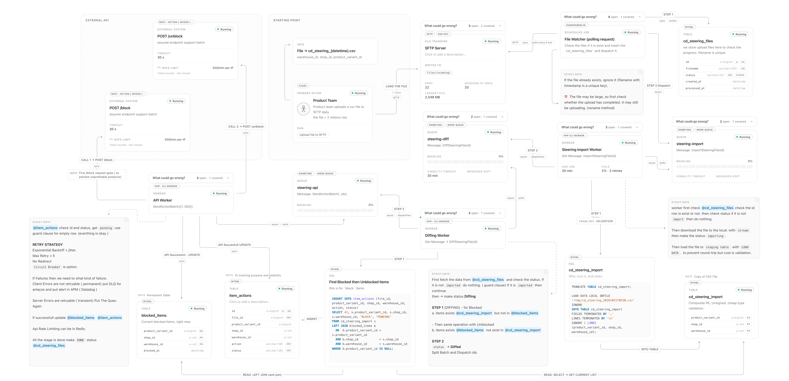

# Cross Docking Steering - Process Design
## High Level Design

## A short note first
I spent around 2-3 hours on this today, including the research and create diagram and test it. Before this I did not work with cross docking or with diffing a big daily CSV file like this, so I first did some research and then built the design step by step.

To be honest, during the interview I was a bit stressed and I could not see the topics clearly, so I wanted to go over it again calmly and show how I would really solve it.

This is a high-level design. I could not show every validation and every detail here, because the design has a lot of branching (what if the file is broken, what if the API fails, what if two files come, and so on). In my normal solution work I do a lot of simulations like this, going through each branch and checking what happens.

So this is a simple version. It can be improved a lot and there are many edge cases that I only noted and did not fully solve. I listed them at the end.

## The problem

Product Team uploads a CSV to SFTP every day (2M+ rows, unknown time) with the items that should not be allowed for cross docking. One item = `product_variant_id + shop_id + warehouse_id`.

We need to compare the file with the items that are blocked right now:

- in the list and already blocked -> do nothing
- blocked but not in the list -> unblock
- in the list but not blocked -> block

Block / unblock is done by calling an external API (the warehouse system). It should be as fast as possible, because every hour of delay means more low profit orders.

## Main idea

Load the file into MySQL, compare it with our current blocked items using SQL, and only send the **difference** (delta) to the external API. Most items don't change from day to day, so the delta is much smaller than 2M.

## Flow

```
Product Team
   | upload csv
   v
SFTP /incoming
   | list every 5 min
   v
File Watcher (scheduled job) ---> cd_steering_files (one row per file)
   | dispatch ImportSteeringFile(id)
   v
[steering-import] -> Import Worker ---> cd_steering_import (LOAD DATA)
   | dispatch DiffSteeringFile(id)
   v
[steering-diff]   -> Diff Worker   ---> item_actions (BLOCK / UNBLOCK, PENDING)
   | dispatch SendActionBatch(ids) - BLOCK first
   v
[steering-api]    -> API Workers   ---> External API (POST /block, POST /unblock)
                                   ---> blocked_items + item_actions (after API ok)
```

Queues are RabbitMQ, workers are Laravel queue workers (PHP CLI).

### 1. File Watcher

- Check `/incoming` every 5 min, only take `cd_steering_*.csv`.
- Insert the filename to `cd_steering_files` with status `DETECTED`. `filename` is a unique key, so if the file was already seen the insert is ignored and nothing happens.
- New file -> dispatch `ImportSteeringFile(id)` to `steering-import`.
- The message only has the id, not the data. The database is the source of truth.

### 2. Import Worker (`steering-import`, 1 consumer)

- Read the row from `cd_steering_files` with the id. If status is not `DETECTED`, do nothing (so the same message twice is safe).
- Status -> `IMPORTING`.
- Download the file from SFTP to local disk with stream (never load 2M rows into PHP memory).
- `TRUNCATE` the staging table, then `LOAD DATA LOCAL INFILE` into `cd_steering_import`. This is much faster than inserting row by row from PHP.
- Validation: count bad rows and check the row count is normal. Trade-off: `LOAD DATA` is fast but it turns bad values into `0` without error, so we must check after.
- Status -> `IMPORTED`, dispatch `DiffSteeringFile(id)` to `steering-diff`.

Only 1 consumer on purpose: there is one staging table, two imports at the same time would break each other.

### 3. Diff Worker (`steering-diff`)

- Guard: status must be `IMPORTED`, then status -> `DIFFING`.
- Two anti joins (LEFT JOIN + IS NULL) write the delta into `item_actions`:

```sql
-- in the file but not blocked -> BLOCK
INSERT INTO item_actions (file_id, product_variant_id, shop_id, warehouse_id, action, status)
SELECT ?, s.product_variant_id, s.shop_id, s.warehouse_id, 'BLOCK', 'PENDING'
FROM cd_steering_import s
LEFT JOIN blocked_items b
  ON  b.product_variant_id = s.product_variant_id
  AND b.shop_id = s.shop_id
  AND b.warehouse_id = s.warehouse_id
WHERE b.product_variant_id IS NULL;

-- blocked but not in the file -> UNBLOCK
INSERT INTO item_actions (file_id, product_variant_id, shop_id, warehouse_id, action, status)
SELECT ?, b.product_variant_id, b.shop_id, b.warehouse_id, 'UNBLOCK', 'PENDING'
FROM blocked_items b
LEFT JOIN cd_steering_import s
  ON  s.product_variant_id = b.product_variant_id
  AND s.shop_id = b.shop_id
  AND s.warehouse_id = b.warehouse_id
WHERE s.product_variant_id IS NULL;
```

Items in both tables are in none of the queries, so they stay as they are.

- Safety check: if UNBLOCK count is too big (for example more than 30% of current blocked items), stop and alert. A broken or half file should not unblock everything.
- Status -> `DIFFED`, split `item_actions` into batches of 500 (`chunkById`) and dispatch `SendActionBatch(ids)` to `steering-api`. **BLOCK batches go first**, because blocking is what stops low profit orders.

### 4. API Worker (`steering-api`, many consumers)

- Read the rows by ids, only `PENDING` ones. If nothing left, do nothing.
- One HTTP request per batch (500 items) to `POST /block` or `POST /unblock`.
- If API is ok: in **one DB transaction** update `blocked_items` (insert for BLOCK, delete for UNBLOCK) and set `item_actions` to `DONE`.
- `blocked_items` is changed only after the API says ok. So it always shows the real state.

## Tables

| Table | What it is |
|---|---|
| `cd_steering_files` | one row per file, `filename` unique, `status` |
| `cd_steering_import` | copy of today's CSV, temporary, composite PK |
| `blocked_items` | items blocked right now (our copy of the warehouse system state), composite PK |
| `item_actions` | the delta to do: BLOCK / UNBLOCK + PENDING / DONE / FAILED |

Status flow for a file: `DETECTED -> IMPORTING -> IMPORTED -> DIFFING -> DIFFED  -> DONE` (or `FAILED`).

## Retry, rate limit, timeouts

- Retry: exponential backoff + jitter, max 5 tries.
- Server errors / timeout / 429 -> retry (transient). Client errors (400) -> no retry, mark `FAILED`, goes to DLQ and alert in Datadog.
- `429` -> wait the `Retry-After` time.
- Block / unblock are idempotent, so a retry after a timeout is safe.
- Rate limit is shared by all API workers, counter in **Redis** (fail-closed: if Redis is down we don't send). The warehouse system also serves live orders, so I would start lower and increase while watching its latency and errors.
- Throughput = rate limit x batch size. A normal daily delta should finish in a few minutes.
- Timeouts: our HTTP client connect 3 s / request 15 s, lower than the assumed API server timeout (30 s)
- If something stays `FAILED`, `blocked_items` was not changed, so tomorrow's diff finds it again. 

## Assumptions

- The file is a full list every day, not a delta.
- The external API supports batch and block / unblock are idempotent.
- `blocked_items` is our local copy; at go-live it is filled once from the warehouse system.
- CSV has a header row.

## Not solved yet / what I would improve

- **Half uploaded file:** a big file can still be uploading when the watcher sees it. I assume the uploader renames the file to `.csv` only when the upload is done. If not, we need another check (for example file size not changing between two polls).
- **More than one file at once:** each file is a full list, so only the newest one matters. Older ones could be skipped.
- **No file today:** keep yesterday's blocks and send an alert if no file came until a certain time.
- **Monitoring:** alerts when a status is stuck too long, metrics for each step in Datadog.
- **First day:** if `blocked_items` is empty, all 2M rows become BLOCK and this takes very long with the rate limit. Needs a seed or a bigger limit.
- Drift: if someone blocks items in the warehouse system directly, our copy is wrong. A full check from time to time would help.
